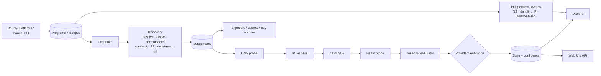

# STOscanner

Continuous subdomain-takeover and attack-surface scanner for bug bounty programs.

STOscanner imports the scopes of your bounty programs, discovers subdomains from
passive and active sources, probes DNS and HTTP, evaluates dangling-DNS and
takeover conditions (subdomain, NS and IP based), and surfaces findings in a web
dashboard and Discord notifications.

This is the single documentation entry point: it covers setup and operation
(§1–§5), a step-by-step walkthrough of the whole pipeline (§6), and an audit of
where the detection logic is sound or wrong (§7). All claims in §6–§7 point at
the file and line that implements them. The audit was done against commit
`d5e91e0` with `pytest -q` → **192 passed** and `ruff check app tests main.py`
clean.

## Contents

- [§1 Features](#1-features)
- [§2 Requirements](#2-requirements)
- [§3 Quick start](#3-quick-start)
- [§4 Docker deployment in detail](#4-docker-deployment-in-detail)
- [§5 Configuration and CLI](#5-configuration-and-cli)
- [§6 How the scanner works, end to end](#6-how-the-scanner-works-end-to-end)
- [§7 Logic audit — does it find issues?](#7-logic-audit--does-it-find-issues)
- [§8 Operating checklist](#8-operating-checklist)
- [§9 Code map and project structure](#9-code-map-and-project-structure)
- [§10 Other documentation and disclaimer](#10-other-documentation-and-disclaimer)

---

## 1. Features

- **Program ingestion** — HackerOne, Bugcrowd, YesWeHack, Intigriti, Immunefi,
  BugBase, HackenProof, Disclose, BugBountyDirectory, plus manual JSON scopes.
  The four main platforms can resync automatically on independent schedules,
  keeping only bounty-paying programs and subdomain scopes.
- **Discovery** — passive sources (subfinder, crt.sh), active brute force
  (puredns/massdns), permutations (alterx), certificate transparency
  (certstream), Wayback, JS scraping and git-secret scanning.
- **Probing** — DNS resolution, HTTP fingerprinting, NS delegation sweeps,
  CDN-aware rate limiting, IP reachability checks.
- **Takeover detection** — subdomain fingerprints, dangling NS zones, and
  orphaned cloud IPs (AWS EIP/Route53, Azure, GCP, DigitalOcean). Claimable
  findings are claimed automatically where a provider API is configured, then
  validated against the live host before being reported as a success.
- **Reporting** — FastAPI dashboard, JSON API/docs, Discord webhook alerts,
  domain-availability ("buy") scanner and exposure scanning.
- **Operations** — Typer CLI for programs/scopes, an always-on daemon,
  pause/resume, and scheduler-driven rechecks.

**Read this before trusting the output:** with the shipped defaults, the NS
sweep, dangling-IP sweep and certstream phase 2 are disabled. Only the
subdomain-CNAME path, SPF/DMARC and platform ingestion run out of the box, and
the dangling-IP scorer has a confirmed defect (D1). See §5 and §7.

---

## 2. Requirements

- Docker Engine 20.10+ with Compose v2.24+ (recommended: runs the app and the
  recon tools)
- Or, for local development: Python 3.12+, PostgreSQL 15+ and Redis 7+, plus
  the recon binaries `subfinder`, `httpx`, `puredns`, `massdns`, `alterx`,
  `gau`, `waybackurls`, `katana`, `trufflehog` (`nuclei` is no longer used)

---

## 3. Quick start

### Docker

```bash
git clone <repo-url> scanner && cd scanner

cp .env.example .env          # then set DB_USERNAME / DB_PASSWORD / REDIS_PASSWORD
docker compose up -d --build  # PostgreSQL + Redis + the web app
```

- Dashboard: <http://127.0.0.1:8000/web/>
- API docs: <http://127.0.0.1:8000/docs>
- Health/stats: <http://127.0.0.1:8000/api/stats>

The scanner daemon is opt-in (`DAEMON_AUTOSTART=false`). Start and stop it from
the dashboard, or from a shell. The web UI and the CLI share the same PID file,
so either side sees the same daemon:

```bash
docker compose exec app python main.py start
docker compose exec app python main.py daemon-status
docker compose exec app python main.py stop
```

### Local development

```bash
python3 -m venv .venv && source .venv/bin/activate
pip install -r requirements.txt

cp .env.example .env                  # DB_HOST=localhost, then set secrets
docker compose up -d postgres redis   # infrastructure only
python main.py web                    # dashboard + API
```

Run the scanner continuously in the background:

```bash
python main.py start          # detached, PID file /tmp/stoscanner-daemon.pid
python main.py daemon-status
python main.py stop
```

Set `DAEMON_AUTOSTART=true` to start it when the web app starts. `python
main.py daemon` remains available as a foreground process.

Install the external recon tools (Debian/Ubuntu, root, Go required):

```bash
sudo ./install-tools.sh
```

Run the test suite (no network or database required):

```bash
pip install -r requirements-dev.txt
pytest -q
ruff check app tests main.py
```

---

## 4. Docker deployment in detail

`docker compose up` starts PostgreSQL 15, Redis 7 and the STOscanner web app.
The app image ships every external recon binary, so no host installation is
required.

### 4.1 Prerequisites and required `.env` values

- Docker Engine 20.10+ with Compose v2.24+ (`docker compose version`)
- A `.env` file in the repository root: `cp .env.example .env`

Set at least the following; Compose refuses to start without them:

```dotenv
DB_USERNAME=postgres
DB_PASSWORD=<choose-a-password>
REDIS_PASSWORD=<choose-a-password>
```

`DB_PASSWORD` is composed into an unescaped PostgreSQL URL and `REDIS_PASSWORD`
into a Redis URL plus the Redis healthcheck shell command, so prefer letters and
digits (an `@`, `/` or `:` can break the connection string or healthcheck).

Keep `DB_NAME=stoscanner`: `init.sql` creates the extensions and timezone for
that database name.

The first build compiles Go and C tools from source and downloads the Python
wheels; expect roughly 10–20 minutes and about 1.4 GB of image layers depending
on CPU, disk and network speed. Later builds reuse the tool-builder and pip
layers and are much faster. Once `stoscanner-app` reports `healthy`, the URLs in
§3 are available. The container listens on `0.0.0.0:8000`; `PORT` in `.env`
selects the published host port, and the Compose mapping publishes on all host
interfaces (see §4.7).

### 4.2 What starts

| Service | Image | Purpose | Persistence |
| --- | --- | --- | --- |
| `app` | built from `Dockerfile` (`stoscanner:local`) | FastAPI web UI/API, initializes DB tables at startup | `findings_data` volume at `/findings` |
| `postgres` | `postgres:15-alpine` | application database | `postgres_data` volume |
| `redis` | `redis:7-alpine` | provisioned but unused by the current code (rate limits are in-process) | `redis_data` volume (AOF) |

`app` starts only after the PostgreSQL healthcheck passes. `init.sql` is mounted
read-only into the PostgreSQL entrypoint; it enables `uuid-ossp` / `pgcrypto` and
sets the database timezone. Application tables are created by the FastAPI
startup hook (`create_tables()`), not by `init.sql`.

### 4.3 Starting the scanner

The container starts **only the web app**. The scanning daemon is intentionally
not auto-started, so restarting the web container does not silently start
scanning traffic. Start it from the dashboard buttons (which call the web API)
or with the CLI commands in §3. The log is `/app/logs/daemon.log`; follow it
with `docker compose exec app tail -f logs/daemon.log`.

The foreground variant is `python main.py daemon` — keep that terminal open;
Ctrl+C stops it. CLI administration works the same way:

```bash
docker compose exec app python main.py status
docker compose exec app python main.py programs-add files/programs_add_example.json --dry-run
```

The web process and the CLI use the same `/tmp/stoscanner-daemon.pid` inside the
container, so a CLI-started daemon is visible to the dashboard. The daemon runs
in a new session and survives a web restart, but a container/process-group stop
kills it; use an external supervisor for always-on runs.

### 4.4 Container configuration

Compose passes `.env` into the app via `env_file`, then overrides what must be
different inside the container:

| Variable | Container value | Notes |
| --- | --- | --- |
| `HOST` / `PORT` | `0.0.0.0` / `8000` | Internal bind; host port comes from `PORT` in `.env` |
| `DB_HOST` / `DB_PORT` | `postgres` / `5432` | Compose service DNS name |
| `DB_USERNAME` / `DB_PASSWORD` | from `.env` | Required; no defaults |
| `DB_NAME` | from `.env` (default `stoscanner`) | Keep `stoscanner` for `init.sql` |
| `REDIS_URL` | `redis://:<REDIS_PASSWORD>@redis:6379/0` | Unused by current code |
| `EXPOSURE_FINDINGS_PATH` | `/findings` (image default) | `findings_data` volume |
| `GIT_CLONE_TMP_DIR` | `/tmp/gitscan` (image default) | Writable in the image |

All other settings from `.env` (API tokens, feature flags, Discord webhook,
rate limits) are passed through unchanged. See `.env.example` and §5. Redis has
no client in the scanner today; it is kept because the stack provisions it and
future code may use it.

### 4.5 Included recon tools

The image is built from `python:3.12-slim` with:

| Tool | Version | Build |
| --- | --- | --- |
| Go | 1.27.4 | pinned release tarball, SHA-256 verified |
| subfinder | v2.17.0 | `go install` |
| httpx | v1.12.0 | `go install` |
| puredns | v2.1.1 | `go install` |
| massdns | v1.1.0 | C build from source |
| alterx | v0.1.0 | `go install` |
| katana | v1.8.0 | `go install` |
| gau | v2.2.4 | `go install` |
| waybackurls | v0.1.0 | `go install` |
| trufflehog | v3.99.9 | `go build` from the pinned source tag |

`nuclei` is intentionally not installed; it is no longer part of the pipeline.
The Dockerfile verifies every binary starts during the build. To change a
version, edit the matching `ARG` near the top of `Dockerfile` and rebuild.
Check the tools inside a running container with `docker compose exec app
subfinder -version` and `docker compose exec app massdns --help`.

### 4.6 Operations, volumes and backups

```bash
docker compose logs -f app          # web app logs (uvicorn)
docker compose logs -f postgres
docker compose restart app
docker compose up -d --build        # rebuild after code or .env changes
docker compose exec app bash        # shell as the stoscanner user
docker compose down                 # stop, keep volumes
docker compose down -v              # stop and DELETE database, Redis and findings
```

Changing `.env` requires `docker compose up -d` to recreate the app container;
`docker compose restart` alone does not pick up new environment values.

Compose manages three named volumes: `stoscanner_postgres_data`,
`stoscanner_redis_data` and `stoscanner_findings_data`. They survive `docker
compose down` and are removed by `docker compose down -v`. Back up PostgreSQL:

```bash
set -a; . ./.env; set +a
docker compose exec -T postgres pg_dump -U "$DB_USERNAME" -d "$DB_NAME" > stoscanner-$(date +%F).sql
```

Copy the raw exposure/git findings out of the app container with `docker compose
cp app:/findings ./findings-backup`; restore with `psql -f` and `docker compose
cp` back into `/findings`. Run backups while the daemon is stopped or accept
that in-flight writes may be missing. The image runs as non-root user
`stoscanner` (UID/GID 10001); named volumes inherit that ownership. If you
replace the findings volume with a host bind mount, make the host directory
writable by UID 10001.

### 4.7 Troubleshooting

- **`required variable DB_PASSWORD is missing a value`** — `.env` is missing or
  incomplete. Run `cp .env.example .env` and set `DB_USERNAME`, `DB_PASSWORD`
  and `REDIS_PASSWORD`.
- **Build is slow or fails downloading Go modules** — the builder needs access
  to `go.dev`, `proxy.golang.org` and GitHub. Retry the build; BuildKit caches
  completed layers. Behind a proxy, configure Docker's build proxy, then run
  `docker compose build --no-cache app` if a partial download poisoned a layer.
- **Image is large** — the Go tools and Python cloud SDKs account for most of
  the ~1.4 GB; the Go toolchain and module cache stay in the builder stage.
- **`app` is unhealthy** — `docker compose logs app` first. The healthcheck
  calls `/api/stats`, which needs the database; confirm `postgres` is healthy
  and that `DB_NAME` is still `stoscanner`.
- **Port already in use** — change `PORT` or `DB_PORT` in `.env`. Redis is
  published on host port 6379; edit the `redis` port mapping if that conflicts.
- **`permission denied` when writing findings** — do not bind-mount a
  root-owned `./findings` over `/findings`; use the named volume or chown the
  host directory to UID 10001.
- **Scanner does nothing after `docker compose up`** — expected: the daemon is
  opt-in. Start it from the dashboard or with `python main.py start`.
- **Dashboard returns 404** — the UI is served at `/web/` and `/web/dashboard`.
- **Dashboard returns 500** — `docker compose logs app` shows the traceback;
  templates and routes are covered by the test suite, so include it in reports.

### 4.8 Security notes

- Credentials live only in `.env` (gitignored) and are passed at runtime; they
  are not copied into the image (`.env` is excluded by `.dockerignore`).
- The app has no authentication. The Compose mapping publishes port 8000 on all
  interfaces; bind it to loopback on shared machines, for example
  `127.0.0.1:${PORT:-8000}:8000`, or put an authenticated reverse proxy in front.
  The daemon control API in particular is unauthenticated (§6.9).
- The container runs as a non-root user, but the application still has broad
  network access by design (it scans external hosts). Use it only against
  programs and assets you are authorized to test.
- For production, use a secrets manager instead of a plain `.env`, back up the
  PostgreSQL and findings volumes, and supervise the daemon deliberately.

---

## 5. Configuration and CLI

### 5.1 Settings and secrets

Settings are read from `.env` through `app/core/config.py`. Every option has a
documented `env=` name; the most important ones:

| Variable | Purpose |
| --- | --- |
| `DB_USERNAME`, `DB_PASSWORD`, `DB_HOST`, `DB_PORT`, `DB_NAME` | PostgreSQL (`DB_PASSWORD` also required by Compose) |
| `REDIS_URL`, `REDIS_PASSWORD` | Provisioned but currently unused; password required by Compose |
| `HOST`, `PORT` | Web server bind address |
| `RATE_LIMIT_PER_DOMAIN`, `GLOBAL_CONCURRENCY_LIMIT`, `*_RATE_LIMIT` | Per-domain, global and per-CDN throttles |
| `H1_API_TOKEN`, `YWH_TOKEN`, `BC_SESSION`, `INTI_TOKEN`, … | Platform API auth |
| `DISCORD_WEBHOOK_URL` | Finding notifications |
| `DAEMON_AUTOSTART` | Start the scanner with the web app (default `false`) |
| `SCAN_INTERVAL_HOURS`, `RESCAN_STALE_HOURS`, `*_RECHECK_HOURS` | Scan and recheck cadence |
| `HACKERONE_SYNC_INTERVAL_DAYS` etc. | Per-platform program resync interval |
| `TAKEOVER_AUTO_ENABLED`, `TAKEOVER_RETRY_HOURS`, `TAKEOVER_RETRY_DAYS` | Automatic claims, validation and retry policy |
| `*_ENABLED` | Feature toggles (discovery, scanners, hunters) |

Never commit `.env`, `gcp.json`, or generated scan output. Cloud takeover
providers need their own credentials (AWS keys, `AZURE_CLIENT_*`,
`GCP_SERVICE_ACCOUNT_*`, `DO_API_TOKEN`, `VERCEL_TOKEN`, `HEROKU_API_KEY`,
`NETLIFY_TOKEN`); every provider can be disabled with its `*_ENABLED` flag.
`files/*.yaml` are loaded once at startup — editing a signature/provider file
requires a daemon restart.

### 5.2 Defaults that turn detection off

| Setting | Default | Effect |
| --- | --- | --- |
| `NS_SWEEP_ENABLED` | `false` | no NS sweep, no dangling-IP sweep, no root NS check, no certstream phase 2 |
| `ACTIVE_DISCOVERY_ENABLED` | `false` | no wordlist brute force |
| `JSSCRAPE_ENABLED` | `false` | no JS subdomain/secret discovery |
| `JS_SECRET_SCAN_ENABLED` | `false` | no inline secret scanning |
| `GIT_SCANNER_ENABLED` | `false` | no repo secret scanning |
| `EXPOSURE_SCAN_ENABLED` | `false` | no sensitive-path scanning |
| `IP_HUNTER_ENABLED` | `false` | no proactive cloud-IP hunting |
| `DANGLING_IP_CLOUD_CLAIM_CHECK` | `false` | no direct claim probes; only PTR/TLS evidence |
| `PROGRAMS_LIMIT_PER_ITERATION` | `10` | at most 10 programs per 60 s iteration |
| `get_scopes_needing_scan(limit=100)` | hardcoded | at most 100 scopes per program per 24 h cycle |
| `/api/findings` `min_confidence` | `70` | the 60–69 band is hidden by default |

`DANGLING_SPF_DMARC_CHECK` is `true` and runs independently of the NS sweep.

### 5.3 CLI commands

```bash
python main.py web                 # FastAPI UI + API; /docs
python main.py start               # detached scanner daemon
python main.py daemon-status
python main.py stop
python main.py daemon              # foreground debug variant
python main.py status              # database statistics

python main.py add-program "Acme" --platform hackerone --scopes "acme.com,*.acme.com"
python main.py programs-add files/programs_add_example.json --dry-run
python main.py update-scope ...    # see D3: avoid wildcard literals
python main.py deactivate-scope ...
python main.py deactivate-program ...
python main.py ingest-platform ...
python main.py sync-platforms ...
python main.py pause
python main.py resume
python main.py clear-all-ip
```

Per-platform imports are also available: `hackerone`, `bugcrowd`, `ywh`,
`intigriti`, `immunefi`, `bugbase`, `hackenproof`, `disclosio`,
`bugbountydirectory`. Note that `add-program` stores scope strings verbatim —
storing `*.acme.com` breaks discovery and notification lookups (defect D3).

---

## 6. How the scanner works, end to end

This section walks through one complete scan cycle: where targets come from,
how subdomains are discovered, how each one is probed, how the code decides that
something is (or is not) takeover-able, and where the logic can be wrong.

### 6.1 The mental model

STOscanner answers four separate questions, and it is important not to mix them
up, because each one has its own data path, its own scoring and its own
failure modes.

| # | Question | Code path | Output |
| --- | --- | --- | --- |
| 1 | **Which hostnames exist?** | `app/discovery/*` | `Subdomain` rows |
| 2 | **Is a hostname pointed at a resource somebody else can claim?** | `TakeoverEvaluator` + provider checkers | `DANGLING` / `CLAIMED` / `POTENTIAL` |
| 3 | **Is a DNS zone, cloud IP, or email record orphaned?** | `app/probing/dns_scanner/*` | NS / dangling-IP / SPF-DMARC findings |
| 4 | **Is it still true?** | `Scheduler` rechecks + `StateManager` | state transitions |

Everything else — Discord, the web UI, the buy scanner, exposure scanning —
consumes the output of those four.



### 6.2 Entry points and startup

`main.py` is a thin dispatcher:

| Command | What starts | Notes |
| --- | --- | --- |
| `python main.py web` | FastAPI (API at `/`, UI at `/web`) | Can auto-start the daemon when `DAEMON_AUTOSTART=true` |
| `python main.py daemon` | `Daemon().run()` in the foreground | Debug mode |
| `python main.py start` | detached daemon | PID file `/tmp/stoscanner-daemon.pid` (override `STOSCANNER_PID_FILE`) shared with the web UI |
| `python main.py stop` / `daemon-status` | PID-file control | The daemon runs in its own session |
| any other command | Typer CLI in `app/core/cli.py` | `add-program`, platform imports, `status`, `pause`, … |

At startup the daemon (`app/core/daemon.py:155-334`) does, in order:

1. create tables / apply enum migrations,
2. refresh the DNS resolver pool (`ensure_resolver_pool`),
3. start provider-side workers (Route 53 and GCP DNS NS-lottery queues),
4. build the CIDR index used by dangling-IP analysis,
5. start every independent background loop that is enabled,
6. enter the main `while self.running` iteration loop.

The components are constructed in `Daemon.__init__`
(`app/core/daemon.py:60-91`). Some are always present, some are conditional:

| Component | Conditional on |
| --- | --- |
| passive, dns, http, evaluator, exposure, permutation, dns_scanner, js_scrape, wayback, certstream | always constructed |
| active | `ACTIVE_DISCOVERY_ENABLED` (default **false**) |
| domain_buy | `DOMAIN_BUY_SCANNER_ENABLED` (default true) |
| **ns_sweep** | **`NS_SWEEP_ENABLED` (default `false`)** |
| ip_hunter | `IP_HUNTER_ENABLED` (default false) |
| git_scanner | `GIT_SCANNER_ENABLED` (default false) |

That single default is the most consequential line in the repository: with
`NS_SWEEP_ENABLED=false`, there is **no weekly NS sweep, no dangling-IP sweep,
no scope-root NS check, and no certstream phase 2**. Only subdomain-CNAME
detection, SPF/DMARC (separate loop) and platform ingestion run out of the box.
See §5.2.

### 6.3 Step 1 — programs and scopes go into the database

#### 6.3.1 Platform import

`app/programs/platforms/*.py` fetch listings from HackerOne, Bugcrowd,
YesWeHack, Intigriti, Immunefi, BugBase, HackenProof, disclose.io,
BugBountyDirectory, plus manual JSON. Each adapter returns a normalised dict:

```python
{
  "name": ..., "external_id": ..., "url": ...,
  "scopes": [ ... ],          # web targets
  "git_scopes": [ ... ],      # github.com/org/repo or org wildcards
  "scope_fetch_failed": False,
  "metadata": {...},
}
```

`PlatformBase.sync_programs()` (`app/programs/base.py:140-224`) then:

1. rejects the whole sync if the listing itself failed (`fetch_error`),
2. marks the run **partial** if any per-program scope request failed,
3. upserts programs (`_create_or_update_program`, matching on `external_id` or
   name),
4. reconciles scopes (`_sync_scopes_with_deduplication`, `base.py:315-422`),
5. reconciles git scopes (additive only),
6. deactivates programs that vanished — only when the listing was complete and
   non-empty (`base.py:424-479`).

Reconciliation is a pure diff (`diff_scope_listing`, `base.py:41-90`):

```
unknown domain                 -> add active
known, inactive, not manual    -> reactivate
known, manually_deactivated    -> never touch (operator excluded it)
known, active, absent upstream -> deactivate, if removals are allowed
```

Deactivating a scope also sets **all of its subdomains to `DEAD`**
(`base.py:398-405`), which removes them from the UI and stops scans.
Reactivating a scope resets only the children that were killed this way
(`base.py:382-393`).

Manual exclusion matters: `deactivate-scope` sets both `is_active=False` and
`manually_deactivated=True` (`app/core/cli.py:502-503`), so a later platform
resync cannot quietly put the scope back.

#### 6.3.2 Scope normalisation — the first place things go wrong

Platform adapters pass raw scope strings through
`app/programs/domain_utils.py:extract_domains()` (`:347-404`). It does three
things:

* expands alternations (`*.example.(com|net)`),
* reduces every hostname to its **registrable domain** (`api.example.com` →
  `example.com`),
* validates the TLD against a hardcoded allowlist (`_VALID_TLDS`, `:236-266`).

Two consequences, both verified by running the function:

```text
'api.example.com'      -> ['example.com']          # scope widened
'*.api.example.com'    -> ['api.example.com', 'example.com']
'https://example.ie'   -> []                       # dropped (tld not allowlisted)
'example.page'         -> []                       # dropped
'https://example.gr/path' -> []                    # dropped
```

Widening `api.example.com` to `example.com` is the documented intent, but it
means a program that only authorises an API host gets its **entire parent
domain** scanned, including hosts the program never listed. The allowlist is
also much smaller than the real TLD space: `.ie`, `.gr`, `.pe`, `.pk`, `.lt`,
`.ee`, `.lv`, `.gh`, `.tz`, `.bd`, `.np`, `.lk`, `.mobi`, `.page`, `.so`, `.one`
and others are silently dropped before import. That is a false negative at the
front door: the program exists, but no scope is ever stored for it.

The CLI path does **no** normalisation at all:

```python
# app/core/cli.py:418-424
scope_list = [s.strip() for s in scopes.split(",") if s.strip()]
for domain in scope_list:
    session.add(Scope(program_id=program.id, domain=domain, ...))
```

The `add-program` example in §5.3 stores a literal `*.acme.com` row. §7.2
explains why that breaks discovery and notification bookkeeping.

#### 6.3.3 What a program looks like in the DB

`app/db/db_models.py`:

* `Program` — `is_active`, `platform`, `last_scan_at`, `external_id`;
* `Scope` — `domain`, `is_active`, `manually_deactivated`, `last_scanned_at`,
  `last_js_scraped_at`, `dns_takeover_notified_at`; unique on
  `(program_id, domain)` — **not** unique on `domain` alone (`:127`);
* `Subdomain` — `name`, `state`, `confidence`, `takeover_provider`,
  `takeover_evidence`, `takeover_retry_at`, DNS/HTTP columns,
  `ip_verdicts`, `ip_free`, `last_scanned_at`, `last_ns_sweep_at`;
  unique on `(scope_id, name)` (`:216`);
* `DiscoverySourceEntry`, `StateTransition`, `Notification`,
  `ExposureFinding`, `JsSecretFinding`, `GitSecretFinding`,
  `DomainAvailability`, `PlatformSyncState`.

`DiscoverySourceEntry.source` uses the `DiscoverySource` enum values
`subfinder`, `crt_sh`, `puredns`, `wayback`, `certstream`, `js_scrape`,
`github`, `org_wordlist` (`db_models.py:220-229`); a few callers write raw
strings such as `"permutation"`.

### 6.4 Step 2 — scheduling: what runs, when

The main loop calls `Scheduler.get_programs_needing_scan()` once per iteration
(`app/core/daemon.py:346-356`, `app/core/scheduler.py:34-77`), then fans out:
program → scopes → subdomains.

| Query | Selects | Default cadence |
| --- | --- | --- |
| `get_programs_needing_scan` | active programs never scanned or `last_scan_at < now - SCAN_INTERVAL_HOURS` | 24 h, limit `PROGRAMS_LIMIT_PER_ITERATION=10` |
| `get_scopes_needing_scan` | active scopes never scanned or stale | 24 h, hardcoded `limit=100` per program |
| `get_subdomains_needing_scan` | subdomains never scanned or `last_scanned_at < now - RESCAN_STALE_HOURS` | 168 h, limit `SUBDOMAINS_LIMIT_PER_SCOPE=1000` |
| `get_potential_subdomains_needing_recheck` | state `POTENTIAL` | `POTENTIAL_RECHECK_HOURS=24` |
| `get_potential_long_subdomains_needing_recheck` | state `POTENTIAL_LONG` | `POTENTIAL_LONG_RECHECK_HOURS=72` |
| `get_dangling_subdomains_needing_retry` | `DANGLING` with `takeover_retry_at` due | `TAKEOVER_RETRY_HOURS=24` |

Two scheduling details matter for interpreting results:

* A program is stamped `last_scan_at` only **after** the background subdomain
  probes it launched have finished (`daemon.py:277-309`), so a slow program does
  not look "done" while work is still in flight.
* The daemon calls `get_subdomains_needing_scan(scope_id=...)` without a state
  filter (`daemon.py:584-586`, `scheduler.py:112-139`), so `DEAD`,
  `FALSE_POSITIVE` and `CLAIMED` rows are re-probed every 168 h. The state
  machine refuses to demote them, but the work is still spent, and a terminal
  row can still reach the provider logic (§7.2, D6).

Independent background loops compete with the main loop for the same global
semaphore (`GLOBAL_CONCURRENCY_LIMIT=100`) and the same DB pool:

| Loop | Interval / trigger | Flag |
| --- | --- | --- |
| certstream | continuous WebSocket | `CERTSTREAM_ENABLED=true` |
| NS sweep | 168 h | **`NS_SWEEP_ENABLED=false`** |
| SPF/DMARC sweep | 168 h | `DANGLING_SPF_DMARC_CHECK=true` |
| exposure scan | every main iteration | `EXPOSURE_SCAN_ENABLED=false` |
| domain-buy scanner | every iteration | `DOMAIN_BUY_SCANNER_ENABLED=true` |
| git scanner | 24 h | `GIT_SCANNER_ENABLED=false` |
| IP hunter | 6 h | `IP_HUNTER_ENABLED=false` |
| platform resync | 60 s poll, per-platform 7-day interval | `PLATFORM_SYNC_ENABLED=true` |

### 6.5 Step 3 — discovery

All discovery writes `Subdomain(scope_id, name)` plus a
`DiscoverySourceEntry(subdomain_id, source)`. Discovery runs inside `_scan_scope`
(`app/core/daemon.py:426-603`). The first-scan flag is `COUNT(subdomains) == 0`.

#### 6.5.1 Passive (`app/discovery/passive.py`) — every scan

* `subfinder -d <scope.domain> -silent` (timeout 120 s, 3 concurrent).
* `crt.sh/?q=%.<scope.domain>&output=json`, split `name_value` on newlines and
  commas, keep only names equal to or ending in `.<scope.domain>`, drop `*.`
  prefixes (`passive.py:131-140`).
* Both are merged, the "primary" source is recorded, and each name is inserted
  with `ON CONFLICT DO NOTHING` (`passive.py:145-192`).

The crt.sh path is filtered. **The subfinder path is not**: stdout lines are
inserted verbatim (`passive.py:102` → `:57-63`). A mis-attributed or stray
hostname from subfinder is stored under the scope and then fully probed.

#### 6.5.2 Active brute force (`app/discovery/active.py`) — first scan only

`puredns bruteforce <wordlist> <domain> --rate-limit 500 --wildcard-tests 5`.
puredns filters wildcard DNS and returns only resolving names; the code also
suffix-checks them (`active.py:186-198`). Requires `ACTIVE_DISCOVERY_ENABLED`
**and** a valid `ACTIVE_WORDLIST_PATH`.

#### 6.5.3 Permutations (`app/discovery/permutation.py`)

Only seeds matching `dev|test|staging|…|v\d+` are permuted (unless
`ALTERX_ENRICH_ALL=true`). `alterx -enrich` generates candidates, one
`puredns resolve` run resolves them all, results are suffix-filtered and
upserted as `PERMUTATION` (`permutation.py:66-165`).

Note the asymmetry: the brute-force run passes `--wildcard-tests 5`, the
permutation resolve run does not (`permutation.py:268-273` vs `active.py:139-148`).
If puredns' resolve defaults do not filter wildcard answers, a wildcard-DNS
scope will "resolve" every permutation. Worth checking on your puredns version.

#### 6.5.4 Wayback (`app/discovery/wayback.py`) — first scan only

`gau <domain> --subs` and `waybackurls <domain>` in parallel; hostnames are
extracted with `urlparse`, IPs are dropped, and only in-scope hosts are kept
(`wayback.py:184-221`). Historical URLs are a good source of names that no
longer resolve — exactly the dangling candidates you want.

#### 6.5.5 JS scraping and JS secrets (`app/discovery/js_scrape.py`, `js_secrets.py`)

Gated by `JSSCRAPE_ENABLED` (default **false**) and re-run every
`JSSCRAPE_RESCAN_HOURS=336`.

1. Collect JS URLs from gau/waybackurls plus a bounded katana crawl.
2. Fetch each unique JS URL with `aiohttp` through the shared per-domain and
   per-CDN rate-limit buckets.
3. Regex-extract in-scope hostnames from the body and upsert them.
4. Scan the body for hardcoded secrets (`js_secrets.py`), persist findings, and
   notify Discord.

#### 6.5.6 Certificate Transparency (`app/discovery/certstream.py`)

A persistent WebSocket to `wss://certstream.calidog.io`. Every certificate's
SAN list is matched against an in-memory cache of active scope roots (refreshed
every 300 s). Matches are upserted and, when
`CERTSTREAM_TAKEOVER_CHECK_ENABLED=true`, immediately pushed through
`_certstream_takeover_probe` (`daemon.py:1991-2140`):

* **phase 1** — DNS + HTTP + provider verification, same as a normal probe;
* **phase 2** — a one-subdomain NS sweep (CIDR lookups, port scan, dangling IP),
  but only if the `ns_sweep` component exists.

This is the only path that reacts in minutes rather than days. It is also the
only discovery path that deliberately bypasses the configured proxy (documented
at `certstream.py:57-61`).

#### 6.5.7 Git secrets (`app/discovery/git_scanner.py`)

Expands `GitScope` rows into `GitProject` repos (GitHub/GitLab API), fetches the
HEAD SHA, skips unchanged repos, clones changed ones one at a time, runs
`trufflehog filesystem --only-verified --archive-max-depth=1`, persists
findings and notifies. Off by default; as shipped it cannot create projects at
all (D10).

#### 6.5.8 What discovery does *not* do

There is no scope re-validation between discovery and probing. Whatever name
lands in `Subdomain` is probed. So a bug that inserts an out-of-scope name (the
unfiltered subfinder path, a widened platform scope, a literal wildcard) turns
directly into out-of-scope traffic.

### 6.6 Step 4 — probing one subdomain

`_probe_subdomain` (`app/core/daemon.py:619-720`) is the heart of the scanner.
For every selected `Subdomain` it does:

#### 6.6.1 DNS probe — `app/probing/dns.py`

* A and AAAA are queried concurrently; each query picks a **fresh random
  resolver from the pool** and retries up to 3 resolvers (`dns.py:57-97`).
* `NXDOMAIN` is taken from the **first successful response**; there is no
  cross-resolver agreement (contrast with NS findings, §6.8.1).
* The CNAME chain is followed up to 5 hops, one random resolver per hop
  (`dns.py:196-235`).
* Results are stored on the row: `cname_target`, `ip_addresses`,
  `ipv6_addresses`, `dns_resolved_at`. `dns_resolver` is set to `NULL` because
  there is no single resolver.

Returns `{resolved, ips, ipv6s, cname, cname_chain, nxdomain}`.

One important limitation, verified against a live resolver: `_extract_rrset`
only keeps records whose owner name equals the queried name (`dns.py:100-107`).
A recursive A answer for a CNAME-fronted host contains the CNAME at the queried
name and the A record at the **target** name:

```text
www.github.com.  CNAME  github.com.
github.com.      A      140.82.121.3
```

The A record is therefore discarded, `ips` stays empty and `resolved` is false
for most SaaS/CDN-fronted hosts (D17).

#### 6.6.2 IP liveness — `app/probing/ip_check.py`

For each A record, TCP-connect to 22/80/443/3389/8080/8443:

* any `open` or `closed` (RST) → **TAKEN**,
* only filtered/errors → **INCONCLUSIVE**,
* a missing IP → not evidence of freedom.

Serialised into `Subdomain.ip_verdicts` and aggregated into `ip_free`
(`daemon.py:642-657`). This is deliberately conservative: generic TCP silence is
never treated as "free". Strong free verdicts come from the dangling-IP
analyzer.

Because of D17, this step is skipped for most CNAME-fronted hosts: the daemon
only calls it when `dns_data["ips"]` is non-empty. RST-based TAKEN verdicts are
also deliberately aggressive — one RST on one port overrides any number of
filtered ports (`ip_check.py:163-174`) — which errs toward "still owned".

#### 6.6.3 CDN gate — `app/core/ratelimit.py`

If the CNAME maps to a known CDN, `check_cdn()` returns a rate-limit action. A
`skip` action stamps `last_scanned_at` and returns **without any HTTP request**
(`daemon.py:673-689`). DNS scoring still ran, so a CNAME-only dangling finding
can still be produced.

#### 6.6.4 HTTP probe — `app/probing/http.py`

`tls_client` with a rotating real-browser TLS profile, full browser headers, 11 s
timeout, redirects followed. Tries `https://` then `http://`. Persists status,
title, body hash, content length, probe time. A TLS/certificate error falls
through to `http://`; mTLS is skipped.

The HTTP layer does not consult the per-domain rate limiter: only the CDN gate
in step 6.6.3 throttles anything, and it only fires when the host has a CNAME
(`http.py` has no `wait_for_domain`/`check_cdn` call at all). Non-CDN targets
are limited only by `GLOBAL_CONCURRENCY_LIMIT` (100). Body size is unbounded and
redirects are followed across hosts, so the fingerprint can describe a
redirected third-party page (D18).

#### 6.6.5 Evaluation — `app/takeover/subdomain_hunter/evaluator.py`

`evaluate(session, subdomain, dns_data, http_data)` returns a dict and is
responsible for the state transition. Details in §6.7.

#### 6.6.6 Alert and stamp

If the resulting state is `DANGLING` or `CLAIMED`, the immediate Discord path
runs (`daemon.py:705-707`). Then `last_scanned_at` is stamped and the session is
committed. Every iteration also runs a batch notification pass for any
`DANGLING` row that has not been alerted (`daemon.py:979-1080`).

### 6.7 Step 5 — how a takeover is judged

#### 6.7.1 States and thresholds

`app/discovery/state.py` is the only place that maps confidence to state
(`state.py:36-54`):

| Confidence | State | Meaning |
| --- | --- | --- |
| 0–29 | `ALIVE` | nothing to report |
| 30–59 | `POTENTIAL` | structurally at risk (live 2xx + claimable CNAME) |
| 60–100 | `DANGLING` | alert-worthy |
| explicit | `POTENTIAL_LONG` | ownership-blocked, slower recheck |
| explicit | `DEAD` | terminal |
| explicit | `FALSE_POSITIVE` | terminal |
| explicit | `CLAIMED` | terminal, claim validated |

`POTENTIAL_LONG` is preserved unless a new score reaches `DANGLING`; terminal
states are never demoted by the ladder (`state.py:86-90`).

#### 6.7.2 The decision tree

`TakeoverEvaluator.evaluate` (`evaluator.py:102-330`):

| Order | Condition | Result |
| --- | --- | --- |
| 1 | state is `CLAIMED` | skip entirely (terminal) |
| 2 | no DNS and no HTTP data | confidence 0, no state update |
| 3 | empty probe + sensitive state | treat as timeout, preserve state (`:129-146`) |
| 4 | CNAME is "internal" (same registrable domain) | confidence 0, `ALIVE` |
| 5 | 2xx + claimable CNAME, no provider error fingerprint | `POTENTIAL`, capped at 59 (`potential.py`) |
| 6 | NXDOMAIN, no CNAME | 0, `ALIVE` — the record does not exist |
| 7 | NXDOMAIN + CNAME + unknown provider | 0, `ALIVE` — cannot confirm claimability |
| 8 | NXDOMAIN + CNAME + non-claimable provider | 0, `ALIVE` |
| 9 | NXDOMAIN + CNAME + provider + contradicting HTTP provider | 0, `ALIVE` |
| 10 | NXDOMAIN + CNAME + provider | score → state |
| 11 | no CNAME, or no provider match | 0, `ALIVE` |
| 12 | provider matched + live page from *different* provider | 0, `ALIVE` |
| 13 | provider matched, otherwise | score → state |
| 14 | provider-specific verification | may override score/state |

The deliberate conservatism in steps 6–9 is good: a dangling record with no
recognisable provider is not reported, because there is no way to prove the
resource is claimable. That removes the biggest false-positive class
(unrecognised CNAME targets).

#### 6.7.3 The score

`app/probing/confidence.py`:

* CNAME match: **40** for a claimable provider, **35** for a non-claimable one
  (`takeover_loader.py:143`).
* NXDOMAIN bonus: **+25** (`confidence.py:27`).
* HTTP body/header fingerprints: their configured weight; positive weights
  count at **half** strength, negative weights count **in full**
  (`confidence.py:122`).
* Match strengths come from `files/signatures.yaml` (e.g. GitHub "Project Not
  Found" +45, Heroku "No such app" +60, S3 `AccessDenied` **−100**).

Worked examples:

| Scenario | Calculation | Score | State |
| --- | --- | --- | --- |
| `dev.acme.com → acme.herokuapp.com`, target NXDOMAIN, no token | 40 + 25 | 65 | `DANGLING` |
| same, page says "No such app" | 40 + 25 + (60 × 0.5) | 95 | `DANGLING` |
| same, page says S3 `AccessDenied` (wrong provider) | HTTP provider ≠ CNAME provider | 0 | `ALIVE` |
| live 2xx Heroku app | potential path | 59 | `POTENTIAL` |
| `dev.acme.com → acme.herokuapp.com`, target resolves, no HTTP | 40 | 40 | `POTENTIAL` |
| CNAME to CloudFront | non-claimable | 0 | `ALIVE` |
| NXDOMAIN, no CNAME | — | 0 | `ALIVE` |

#### 6.7.4 Provider verification and automatic claims

`ProvidersEvaluator.verify` (`providers_evaluator.py:399-589`) runs after the
score is computed:

1. If the provider is in `nxdomain_required` and the CNAME still resolves →
   `NOT_VULN`, confidence 0 (`:432-455`).
2. Non-claimable provider → confidence 0.
3. Providers with no checker (`_NOT_IMPL_PROVIDERS`) → `NOT_IMPL`, score capped
   at **72**, which is still above the alert threshold (`:473-479`).
4. A per-subdomain/provider cooldown and a global 1 req/s token bucket gate real
   API calls (`:481-497`).
5. Persisted retry time in the future → skip (`:511-517`).
6. **Parent/apex guard**: scope root or registrable apex → verification returns
   without attempting a claim (`:519-524`).
7. Global `TAKEOVER_AUTO_ENABLED` switch.
8. **Attempt gate**: only a finding already at `DANGLING` (≥ 60) may create a
   provider resource (`:547-556`).
9. Dispatch to Vercel / GitHub / Heroku / Netlify / S3 / API Gateway / Azure /
   Wix checkers.

A provider API saying "domain accepted" is not enough. `_accept_or_reject_claim`
(`:659-715`) fetches the hostname and only promotes to `CLAIMED` if it serves
`TAKEOVER_CLAIM_MARKER` (default `STO by Rizin`). Otherwise the status is
downgraded to `FAIL` and retried later. This is a strong design: it makes
"claimed" a verified fact rather than an API response.

`retry_policy.py` decides the retry interval from the outcome, and
`takeover_retry_at` is persisted so concurrent tasks and daemon restarts respect
it.

#### 6.7.5 Where the judgement is weakest

The whole tree trusts `dns_data["nxdomain"]`. That value comes from one resolver
response (§6.6.1). A resolver that returns NXDOMAIN for a name that actually
exists converts a perfectly healthy CNAME into the classic 40 + 25 = 65
`DANGLING`. Providers with API credentials will usually catch it; providers
without a checker (capped at 72) or without configured credentials will not.

### 6.8 Step 6 — the independent sweeps

#### 6.8.1 NS sweep (`app/probing/dns_scanner/ns_checker.py`)

For every scope root and every subdomain (weekly, when enabled), the scanner
asks the **parent zone** for the NS set with recursion disabled, then checks each
nameserver:

| Check | Signal | Confirmation |
| --- | --- | --- |
| AWS Route 53 NS-set mismatch | recursive NS answer ≠ authoritative answer | `confirm_aws_ns_mismatch` |
| rcode-based takeover | `SERVFAIL` / `REFUSED` / `NXDOMAIN` from a nameserver that is supposed to host the zone | `confirm_ns_rcode`, ≥ 2 trusted resolvers must agree (`ns_confirmation.py`) |
| Lame delegation | NS resolves but returns `REFUSED`/`SERVFAIL` for the zone | trusted-resolver confirmation |
| Unresolvable NS host | nameserver hostname itself does not resolve | confirmation pool retry |
| Wildcard CNAME | every name under the scope follows one dangling CNAME | checked first, independent of NS resolution |
| CNAME hop / NXDOMAIN target | intermediate CNAME target is claimable | — |

The cross-confirmation design (`NS_CONFIRMATION_MIN_AGREE=2`, ~16 trusted
resolvers, 10 queries/s) is the right way to avoid random-resolver lies.
Findings are deduplicated per provider and sorted so confirmed mismatches come
before informational `NS_UNRESOLVABLE`.

**But** the daemon only alerts on findings whose provider is in
`files/dns_takeover_providers.yaml`; "Lame Delegation" and
`WILDCARD_CNAME`/`CNAME_HOP_AVAILABLE` are explicitly dropped
(`daemon.py:132-141`). Lame delegation is a real takeover vector — the zone was
deleted at the provider while the registrar delegation remains — so it is
detected, logged, and then not reported.

#### 6.8.2 Dangling cloud IP (`app/probing/dns_scanner/ip_analyzer.py`)

For every A/AAAA record (and CNAME terminal, and MX target) that falls inside a
known provider CIDR (or maps to a provider ASN):

1. TCP port scan and HTTP/HTTPS probe.
2. PTR lookup and `analyze_ptr()` (`ip_indicators.py:242+`) → release /
   allocation indicators.
3. TLS certificate check — a certificate for a *different* company is a strong
   signal that the IP was reassigned.
4. Optional direct cloud claim probes (`DANGLING_IP_CLOUD_CLAIM_CHECK=false`).
5. `score_finding()` combines: base 50, +15 per free signal, −20 per allocation
   signal, −15 for DigitalOcean anchor behaviour, ≥ 60 means confirmed free
   (`ip_indicators.py:748-829`).

The analyzer is only *actionable* if `confirmed_free`, a foreign TLS
certificate, or a confirmed cloud claim (`sweeper.py:548-554`). This is where a
confirmed scoring defect lives — see D1 in §7.2.

#### 6.8.3 SPF / DMARC (`ip_indicators.py:check_spf_dmarc`)

Weekly for each scope root, on by default:

* parse the SPF TXT record, extract `include:`/`redirect=` targets, flag targets
  that are NXDOMAIN or whose NS zone is claimable;
* check `_dmarc.<scope>` NS delegation.

Findings are notified with a 24 h per-scope cooldown. This is a separate path
from the NS sweep and is **not** disabled by `NS_SWEEP_ENABLED=false`. It uses
the system resolver rather than the configured pool (`ip_indicators.py:1048`).

#### 6.8.4 Exposure scanner (`app/probing/exposure_scanner.py`)

Off by default. Each iteration picks 100 random live subdomains and probes the
next unchecked path from `exposure_paths.yaml`, highest priority first. Five
false-positive layers: SPA/catch-all canary check, content-type family, HTML body
rejection, signature strings, minimum body length (`exposure_scanner.py:1-40`,
`:669-760`).

#### 6.8.5 Domain buy scanner (`app/probing/domain_buy_scanner.py`)

On a scope's first scan, one WHOIS lookup records the expiry date. When a domain
expires, a DNS availability check decides whether to notify; if it still
resolves, WHOIS is re-run. Notifications are de-duplicated per
`DOMAIN_BUY_RENOTIFY_HOURS`.

#### 6.8.6 IP hunter (`app/takeover/ip_hunter/`)

Off by default. Cycles scored /24 blocks and runs the same dangling-IP analysis
with provider APIs. This is the proactive counterpart to the NS sweep.

### 6.9 Step 7 — alerts and presentation

#### 6.9.1 Discord

* Immediate path: fired from the probe when the state is `DANGLING` or
  `CLAIMED` (`daemon.py:2141-2229`).
* Batch path: every iteration, up to 50 `DANGLING` rows with no notification at
  the same or a higher confidence (`daemon.py:979-1080`).
* Dedup is based on `Notification.subdomain_id` +
  `Notification.confidence >= current confidence`. **A confidence increase
  re-alerts**; a confidence decrease stays silent.
* Cooldowns for DNS/NS/SPF findings reuse `Scope.dns_takeover_notified_at`
  (24 h by default).

Finding-specific notifiers live in `app/notify/discord.py`: subdomain takeover,
NS takeover, dangling IP, exposure, SPF/DMARC, domain-buyable, git secrets.

#### 6.9.2 Web UI and API

`app/web/api.py` exposes `/api/programs`, `/api/scopes`, `/api/subdomains`,
`/api/findings`, `/api/latest-findings`, `/api/stats`, per-program and
per-subdomain detail, JS/git secret lists, and daemon control
(`/api/daemon/start|stop|restart`). `app/web/web.py` renders the dashboard,
findings, programs, subdomains and detail pages.

Two filters are worth knowing when reading the UI:

* findings default to `confidence >= 70` and `last_scanned_at` within 24 h
  (`api.py:191-207`, `web.py:159-170`) — the `60–69` `DANGLING` band is
  invisible by default, and there is no state filter, so `DEAD` rows that still
  carry a high score can appear as "findings";
* the daemon control endpoints have **no authentication** (`api.py:481-500`).
  Do not expose the web app beyond localhost/trusted networks.

---

## 7. Logic audit — does it find issues?

### 7.1 Scorecard

| Detection class | Design | Current state | Verdict |
| --- | --- | --- | --- |
| Subdomain CNAME takeover | Conservative tree, provider verification, marker-validated claims | Two concrete bugs (D2/D3, plus D7 for false NXDOMAIN) degrade ccTLD and wildcard cases | **Mostly sound**, but fix the registrable-domain and scope-normalisation bugs |
| Dangling NS | Strong: parent-zone query, rcode checks, multi-resolver confirmation, AWS mismatch path | Off by default; lame delegation deliberately not alerted | **Sound logic**, wrong defaults/policy |
| Dangling cloud IP | Good signal set | Primary indicator scoring is broken (D1); claim probes off by default | **Effectively silent** until D1 is fixed |
| SPF/DMARC | Reasonable, conservative | On by default; single resolver; no confirmation | **Works**, low false-positive risk |
| Exposure / JS / git / buy | Layered false-positive controls | Off by default (except buy); git scanner is non-functional (D10) | **Feature-flagged** |
| Platform ingestion | Rich filters, partial-fetch guards | Widens scope to eTLD+1, drops valid TLDs, truncation not treated as partial | **Needs care** |

The single most important conclusion: **the conservative subdomain-CNAME path is
the only one that is both enabled and mostly correct out of the box.** If you
deploy with defaults and expect NS or dangling-IP findings, you will get none.

### 7.2 Confirmed defects

Severity: **S1** = produces wrong findings or silently misses real ones;
**S2** = materially degrades coverage or wastes capacity; **S3** = operational
or cosmetic.

#### D1 (S1) — dangling-IP scoring counts "unallocated" as "allocated"

`app/probing/dns_scanner/ip_indicators.py:810-822` matches keywords with
substring tests:

```python
free_signals = sum(1 for s in indicators
    if any(kw in s.lower() for kw in ("released", "unallocated", "free")))
allocated_signals = sum(1 for s in indicators
    if any(kw in s.lower() for kw in ("allocated", "running", "reserved", "behind", "infrastructure")))
```

"unallocated" contains "allocated". Every release indicator that says
"unallocated" therefore adds +15 **and** subtracts −20. Measured directly:

```text
score_finding(["no PTR record (AWS releases the address when the IP is unallocated)"], [], False, None, None)
  -> (45, False)      # documented expectation: (65, True)
score_finding(["bare in-addr.arpa reverse (no PTR set — IP unallocated)"], [], False, None, None)
  -> (45, False)      # documented: (65, True)
score_finding(["released"], [], False, None, None)
  -> (65, True)       # keyword without the collision works
```

Effect: the two most common "this cloud IP is free" indicators (absent PTR whose
provider config says `no_ptr_means: released`, and a bare reverse name) fall
below the 60 threshold. The dangling-IP analyzer then reports
`confirmed_free=False`, and `_is_actionable` rejects the finding unless a foreign
TLS certificate or cloud claim probe also fired. This is a systematic false
negative on the primary dangling-IP path.

Fix: tokenise the indicators (word boundaries) and evaluate release signals
before allocation signals, or use distinct prefixes such as `release:` /
`allocated:` instead of free-text keywords. Add a regression test asserting
`(65, True)` for the AWS no-PTR indicator.

#### D2 (S1) — registrable-domain logic ignores the Public Suffix List

`app/takeover/subdomain_hunter/evaluator.py:48-75` hardcodes a 15-entry
two-level TLD list and otherwise takes the last two labels. Measured:

```text
example.com.tr      -> com.tr        (should be example.com.tr)
api.example.com.tr  -> com.tr
example.co.id       -> co.id
example.com.sg      -> com.sg
foo.gouv.fr         -> gouv.fr
```

Two downstream effects, both verified:

* `_is_internal_cname("api.example.com.tr", "unclaimed-app.herokudns.com.tr")`
  returns **True**, because both collapse to `com.tr`. The finding is filtered as
  an "internal CNAME" and the subdomain is set to `ALIVE` (evaluator step 4).
* `is_parent_domain("example.com.tr")` returns **False**
  (`providers_evaluator.py:299-318`), so the apex auto-claim guard is bypassed
  for every ccTLD not on the list. A scope root can be sent to a provider
  checker and claimed.

The rest of the project already uses `tldextract` for this
(`app/programs/domain_utils.py:269-296`). The evaluator should use it too.
`app/probing/domain_buy_scanner.py:58-75` has the same heuristic.

#### D3 (S1) — manual scopes are stored verbatim and break discovery/notification

`app/core/cli.py:401-457` stores CLI scope strings exactly as typed. The
`add-program` example in §5.3 stores `*.acme.com`.

Consequences:

* `subfinder -d '*.acme.com'` returns nothing, and the crt.sh filter compares
  against the literal `*.acme.com` (`passive.py:112,137`) — so passive discovery
  for that scope is empty. Every other enricher has the same suffix test.
* When a DNS/NS/SPF finding is produced, the daemon strips the wildcard to the
  root (`daemon.py:752-761`, `1278-1290`) and then looks up the scope with
  `Scope.domain == finding.scope_domain` (`daemon.py:1552`,
  `daemon.py:1368`). A row stored as `*.acme.com` never matches `acme.com`:
  `scope_id` stays `None`, the program name is "unknown", and the
  `dns_takeover_notified_at` cooldown is never stamped — so the same finding is
  re-alerted on every sweep.
* If the same program also stores `acme.com`, the duplicate scope makes
  `ActiveDiscovery.upsert_subdomains` raise `MultipleResultsFound`
  (see D4).

Fix: normalise in `_add_program`/`_update_scope` (strip scheme/path/port, leading
`*.`, lowercase, validate TLD), reject duplicates across the same program, and
use `extract_domains` for manual input too. Existing rows need a one-off
normalisation migration.

#### D4 (S1) — duplicate `Scope.domain` across programs kills all funnel upserts

`Scope` is unique on `(program_id, domain)`, not on `domain`
(`db_models.py:127`). But the shared upsert helper looks up by domain alone with
`scalar_one_or_none()`:

```python
# app/discovery/active.py:289-299
stmt = _select(Scope).where(Scope.domain == scope_domain)
scope = result.scalar_one_or_none()
```

Two programs listing the same domain (common on HackerOne + Bugcrowd) produce
two rows. `scalar_one_or_none()` raises `MultipleResultsFound`. Every caller —
wayback, JS scraping, permutation, certstream — wraps the call in a broad
`except` that returns `[]` (`permutation.py:351-362`, `certstream.py:279-282`,
`daemon.py:1949-1952`). Discovery for that domain silently stops. `cli.py:482-485`
has the same pattern for deactivation.

Fix: filter `is_active`, order deterministically, and insert into *each* matching
scope (or pick one canonical scope and document it). Do not use
`scalar_one_or_none()` on a non-unique column.

#### D5 (S1) — `NS_SWEEP_ENABLED=false` disables most of the product

`app/core/config.py:178` and `.env.example:125` default the NS sweep off. Because
the `ns_sweep` component is only constructed when the flag is true
(`daemon.py:80-84`), the following never run:

* the weekly NS sweep loop (`daemon.py:233-235`);
* scope-root NS checks (`_ns_sweep_scope_roots` is only called from that loop);
* wildcard-A dangling-IP checks on roots;
* dangling-IP analysis on ordinary subdomains;
* certstream phase 2 (`daemon.py:2064-2070` returns early).

Only the SPF/DMARC loop is independent of this flag. If NS/IP detection is meant
to be a core feature, default it on (or split the flag so root NS checks do not
require the expensive per-subdomain sweep).

#### D6 (S2) — `get_subdomains_needing_scan` has no state filter

`scheduler.py:112-139` selects on `scope_id` and `last_scanned_at` only when the
daemon calls it (`daemon.py:584-586`); the optional `state` parameter exists but
is never passed there. After `RESCAN_STALE_HOURS=168`, `DEAD`, `FALSE_POSITIVE`
and `CLAIMED` rows are re-probed. The ladder preserves terminal states, so the
result is not usually a wrong finding, but:

* capacity is spent on hosts that were deliberately retired;
* a `DEAD` row can still reach provider verification, and explicit transitions
  (e.g. `POTENTIAL_LONG`, `CLAIMED`) can override `DEAD`;
* the Wix path assumes DEAD means "never rescanned", which is not true.

Fix: exclude the terminal states in the query (the NS sweep already does this at
`daemon.py:1200-1215`).

#### D7 (S2) — one resolver decides NXDOMAIN

`app/probing/dns.py:57-97` returns the first successful response and never asks
a second resolver to agree. A resolver that blocks a domain (returns NXDOMAIN)
or a transient authoritative failure turns a live CNAME into the classic
40 + 25 = 65 `DANGLING`. Providers with configured APIs will usually disprove it;
providers without a checker (capped at 72) or without credentials will alert.

Fix: require NXDOMAIN from at least two independent resolvers (or confirm with
the trusted pool used by `ns_confirmation.py`) before scoring the +25 bonus.
This is the same standard the code already applies to NS findings.

#### D8 (S2) — platform pagination truncation is not treated as a partial fetch

`PlatformBase.listing_complete` is initialised to `True` and **never set to
`False`** (`base.py:112,156`). Removals are allowed whenever
`not partial_fetch and listing_complete and bool(programs_data)`
(`base.py:163-177`), and `partial_fetch` only reflects failed per-program scope
requests.

Several adapters can legitimately stop paginating early when listing metadata is
missing. Intigriti is the clearest: `max_count = int(data.get("maxCount", 0))`
and `if offset >= max_count or not records: break` (`intigriti.py:307-318`). If
`maxCount` is absent, the first page is treated as the complete listing. The
missing programs are then deactivated, and all their subdomains set `DEAD` —
a large, silent false negative.

Fix: have each adapter set `listing_complete=False` (or raise a partial flag)
when it stops because of missing metadata or a guessed limit, and keep the
"never deactivate on a partial listing" guard meaningful.

#### D9 (S2) — the resolver file handed to puredns can be stale

`get_resolvers_file()` creates the temp file once and returns it forever
(`resolvers.py:125-145`). `ensure_resolver_pool()` and `warm_resolver_pool()`
update the in-memory pool and prune dead entries but never rewrite the file. On a
fresh start the file is written during `ActiveDiscovery.__init__`, potentially
before the pool refresh finishes, and then keeps that content for the process
lifetime. puredns/alterx can therefore run with the wrong (or default 1.1.1.1 /
8.8.8.8) resolver set.

Fix: rewrite the file whenever the pool changes (compare a generation counter),
or have `get_resolvers_file()` always regenerate on pool version change.

#### D10 (S2) — the git scanner cannot create projects

`GitProject` requires `git_scope_id` (`db_models.py:450`), but both insert paths
pass `scope_id` (`git_scanner.py:249-256`, `278-283`). SQLAlchemy raises
`TypeError: 'scope_id' is an invalid keyword argument`; `_expand_scopes` catches
it, logs, and never stamps `last_expanded_at`, so the same scopes are retried
forever and no project is ever scanned. Two further bugs would still lose
repositories after that is fixed: the HEAD SHA is stamped even when the clone or
trufflehog run failed (`git_scanner.py:514-520`, `_update_project`), so failed
repos are skipped as "unchanged", and the offset pagination advances over rows
that consumers are concurrently re-stamping (`git_scanner.py:421-491`).

Fix: use `git_scope_id`, stamp the SHA only on a successful scan, and paginate by
`id > last_id` rather than offset.

#### D11 (S2) — passive subfinder output is inserted without a scope check

Every other discovery source filters by suffix; subfinder does not
(`passive.py:102,57-63`). A stray FQDN becomes a fully probed `Subdomain`. This
is the only out-of-scope write path in discovery.

Fix: apply the same `name == domain or name.endswith("." + domain)` test used by
crt.sh, and reject wildcard literals and trailing dots.

#### D12 (S2) — HTTP scoring collapses to one provider

`ConfidenceScorer.score_http` sums weights per provider and then returns only
`max(scores)` (`confidence.py:85-105`). Positive evidence from several providers
is discarded, and a strong negative fingerprint (−100) can be outvoted by a small
positive score from another provider. In the CNAME path the provider-mismatch
guard usually suppresses that, but the scoring is not expressing what the
docstring claims ("AccessDenied must suppress the finding").

Fix: compute the overall contribution as the sum of the strongest positive and
the strongest negative signal, or let any negative fingerprint veto regardless of
provider.

#### D13 (S3) — the NS sweep can loop forever if stamping fails

`_ns_sweep_loop` paginates with `last_ns_sweep_at < sweep_start` and stops only
on a short batch (`daemon.py:1202-1242`). `_persist` swallows a failed
`last_ns_sweep_at` update (`sweeper.py:1015-1036`). With ≥ `NS_SWEEP_BATCH_SIZE`
rows and a persistent DB error, the same batch is fetched again forever. Also,
running a one-subdomain sweep from certstream stamps `last_ns_sweep_at`, which
pushes that host's next weekly sweep out by up to 168 h (`daemon.py:2096-2123`).

Fix: track processed IDs in the loop and break when a batch makes no progress;
add a `reason`/`source` flag to `run_sweep` so certstream sweeps do not stamp the
weekly cursor.

#### D14 (S3) — aiohttp cannot use a SOCKS proxy

The code recommends `HTTP_PROXY=socks5://…` (`passive.py:115-117`,
`js_scrape.py:31-34`), but `aiohttp` only supports HTTP proxies. The resulting
exception is swallowed at `debug` level (`passive.py:141-143`,
`js_scrape.py:436-438`), so crt.sh and all JS fetching silently return nothing
whenever a SOCKS proxy is configured. `tls_client` and `httpx` paths support
SOCKS, which makes the failure easy to miss.

Fix: use `aiohttp-socks` for these two call sites, or document that `HTTP_PROXY`
must be `http://` and log a warning when a `socks` scheme is detected.

#### D15 (S3) — notification dedup and delivery gaps

* Dedup re-alerts on any confidence increase (`daemon.py:981-1000`,
  `2161-2171`), because the test is `Notification.confidence >= current`.
  A finding that moves 65 → 66 → 67 alerts three times.
* The immediate and batch paths both read "not notified" before either writes,
  and there is no unique constraint on `notifications`; a race sends duplicates.
* `_send_single_notification` swallows every failure (`discord.py:266-272`), but
  the daemon still writes `Notification` rows afterwards
  (`daemon.py:1064-1080`). A Discord outage permanently loses those alerts.
* The webhook is optional at construction; if it is absent, `notify()` returns
  early but the daemon still stamps notifications.

Fix: unique index on `(subdomain_id, channel, confidence)` or a "notified at
this state version" column; write the row only after a successful send; make
dedup key on state+evidence, not confidence.

#### D16 (S3) — web filters hide or mislabel findings

* `/api/findings` and `/web/findings` default to `confidence >= 70`, but
  `DANGLING` starts at 60 (`state.py:36`, `api.py:191`, `web.py:159`). A real
  65-score dangling CNAME is notified to Discord but invisible in the default
  UI.
* Neither query filters `state`, so `DEAD`/`FALSE_POSITIVE` rows (which keep
  their confidence after scope removal) appear as fresh findings.
* `/api/scopes` reads `s.program.name` after only eager-loading
  `Scope.subdomains` (`api.py:106-120`); the lazy `program` relationship raises
  `MissingGreenlet` in the async session, so the endpoint 500s.
* The daemon control endpoints have no auth (`api.py:481-500`).

Fix: add `Subdomain.state == DANGLING` to finding queries, align the UI default
with the state threshold, eager-load `Scope.program`, and put daemon control
behind a token or localhost-only binding.

#### D17 (S2) — A records at the CNAME target are thrown away

`_extract_rrset` requires `rrset.name == qname` (`app/probing/dns.py:100-107`).
As shown in §6.6.1, a recursive answer for a CNAME-fronted host carries the A
record under the **target** name, so it is dropped: `ips=[]`, `resolved=False`.

Measured against 1.1.1.1 for `www.github.com`:

```text
rcode 0
www.github.com. CNAME github.com.
github.com.     A     140.82.121.3
```

Effect: `Subdomain.ip_addresses` stays `NULL` for most SaaS/CDN-fronted hosts,
and the daemon's per-IP liveness check (`daemon.py:642`) never runs for them.
The weekly NS sweep is unaffected because it resolves IPs itself
(`resolve_to_ips`), but the fast per-probe IP signal and any future use of
`resolved` are lost.

Fix: collect A/AAAA rrsets from the whole answer section after following the
CNAME chain, not only the rrset owned by the queried name.

#### D18 (S2) — HTTP probing is not rate-limited per target

`app/probing/http.py` performs a fresh `tls_client` GET for every probe with no
call into `app/core/ratelimit.py`. Only the CDN gate in `_probe_subdomain`
throttles, and only when a CNAME exists (`daemon.py:673-689`). Direct-A targets
are limited solely by `GLOBAL_CONCURRENCY_LIMIT=100`.

The probe also has no response-size cap (`response.text`, `http.py:160-166`) and
follows redirects across hosts (`allow_redirects=True`, `:153`). For a
bug-bounty scanner this is both an OPSEC and a correctness issue: a redirect to
a provider error page can match a fingerprint for a provider the target does
not use.

Fix: route every probe through `rate_limit_manager.wait_for_domain(host)`,
cap the body read (e.g. 1–2 MB), and do not follow cross-host redirects when
fingerprinting.

#### D19 (S3) — domain-buy scanner: same 2-level heuristic, plus a hot loop

`_extract_root_domain` (`domain_buy_scanner.py:58-74`) treats any second-level
label of ≤ 3 characters as a two-part TLD:

```text
www.abc.com    -> www.abc.com   (wrong; should be abc.com)
sub.app.foo.io -> app.foo.io    (wrong; should be foo.io)
```

It is fed `Scope.domain` at first scan (`daemon.py:446-451`). A scope stored as
a subdomain can therefore be WHOIS-queried as if it were the registrable domain;
WHOIS "not found" plus a NXDOMAIN DNS answer is classified as **buyable** and
notified immediately (`domain_buy_scanner.py:435-462`).

Separately, when DNS says NXDOMAIN but WHOIS fails, the row is set to `UNKNOWN`
without clearing `expires_at` (`:786-803`). `_get_expired_domains` selects every
non-`AVAILABLE` row with `expires_at <= now` (`:709-720`), so that row is
re-checked on **every** daemon iteration (60 s) instead of the intended 48 h
retry gate.

Fix: use `tldextract`/PSL (as `domain_utils` already does) for the root domain,
clear or advance `expires_at` when marking `UNKNOWN`, and only notify after the
Discord send succeeds.

#### D20 (S3) — exposure scanner records transient failures as "checked"

`_check_path` returns `None` for timeouts, 5xx and broad exceptions
(`exposure_scanner.py:687-694`, `755-756`), but the caller still adds the path to
`exposure_checked_paths` (`:591-592`). A single timeout on `/.env` means that
path is never probed again for that host. The SPA catch-all check is also
one-shot: one canary returning 200 (including a WAF/login redirect, since
redirects are followed) marks **all** paths as checked permanently
(`:578-585`). The scanner is HTTPS-only, so HTTP-only hosts produce nothing.

Fix: distinguish "checked, not found" from "not checked — retry", add an expiry
to the catch-all verdict, and try `http://` as a fallback.

### 7.3 False-positive / false-negative summary

**Most likely false negatives**

1. Dangling IPs: D1 (keyword collision) plus D5 (sweep off) — the entire class
   can be silent.
2. ccTLD/2-level-suffix subdomains: D2 (internal-CNAME filter / apex guard).
3. Wildcard-stored scopes: D3 (`*.example.com` yields no discovery and no scope
   lookup for notifications).
4. Overlapping scopes across programs: D4 (`MultipleResultsFound` kills
   wayback/JS/permutation/certstream for that domain).
5. Whole programs: D8 (pagination truncation → mass deactivation) and the TLD
   allowlist in `extract_domains` (`.ie`, `.gr`, `.page`, …).
6. NS lame delegation: detected but deliberately not alerted (§6.8.1).

**Most likely false positives**

1. A resolver that lies about NXDOMAIN turns a live CNAME into `DANGLING` (D7).
2. Out-of-scope hosts scanned because platform ingestion widens to eTLD+1
   (`domain_utils.py:347-404`) or because subfinder output is unfiltered (D11) —
   technically real DNS findings, but not in the program's scope.
3. A provider whose API is not configured and whose page returns no fingerprint:
   the heuristic 40/65 score stands (capped at 72 for `NOT_IMPL`).
4. Alert noise from D15 (re-alerts on confidence changes) and D16 (stale rows in
   the UI).

### 7.4 How the defects were verified

All of the following were run locally during the audit:

```text
$ .venv/bin/python -c 'from app.probing.dns_scanner.ip_indicators import score_finding; ...'
aws no-ptr:      (45, False)     # expected (65, True)
bare reverse:    (45, False)     # expected (65, True)
"released":      (65, True)

$ .venv/bin/python -c 'from app.takeover.subdomain_hunter.evaluator import _registered_domain; ...'
example.com.tr   -> com.tr
example.co.id    -> co.id
example.com.sg   -> com.sg
foo.gouv.fr      -> gouv.fr
example.co.uk    -> example.co.uk
is_parent_domain("example.com.tr") -> False
_is_internal_cname("api.example.com.tr", "unclaimed-app.herokudns.com.tr") -> True

$ .venv/bin/python -c 'from app.programs.domain_utils import extract_domains; ...'
'api.example.com'         -> ['example.com']
'https://example.ie'      -> []
'example.page'            -> []
'foo.example.com:8443'    -> ['example.com']
```

Everything else in §7.2 was verified by reading the cited code paths and, where
indicated, by checking that the guard/flag is never set anywhere else in the
repository (`listing_complete`, `GitProject.scope_id`, `last_ns_sweep_at`).

---

## 8. Operating checklist

If you want to trust the output, do these in order:

1. **Turn on what you expect to run.** Set `NS_SWEEP_ENABLED=true` if you want
   NS/IP findings; confirm `DANGLING_SPF_DMARC_CHECK` and the discovery flags.
2. **Check scopes after import.** `python main.py status` and the
   `/api/scopes` endpoint should show registrable domains only, no `*.`, no
   schemes, no duplicate domains across active programs. Fix D3/D4 before a
   production run.
3. **Verify TLD coverage.** If your programs use `.ie`, `.gr`, `.page`, `.mobi`
   etc., imported scopes may be missing; extend `_VALID_TLDS` or switch
   `is_valid_domain` to the PSL.
4. **Check provider credentials.** A finding is only "verified" when the
   provider API is configured. Without tokens, the heuristic score is reported;
   read the takeover label in Discord before acting.
5. **Watch the first NS sweep.** With D1 unfixed, dangling-IP counts will be
   close to zero. Compare a known-free IP's `ip_verdicts` with the analyzer's
   indicators before concluding an IP is safe.
6. **Do not expose the web UI.** Daemon control is unauthenticated.
7. **Re-run `pytest -q` and `ruff check app tests main.py` after any fix**, and
   add a regression test per defect (the suite already covers state, confidence,
   platform filters, takeover policy and web routes).

---

## 9. Code map and project structure

### 9.1 Code map

| Concern | Where to look |
| --- | --- |
| Entry point / process control | `main.py`, `app/core/cli.py`, `app/core/daemon.py:155-334` |
| Settings and defaults | `app/core/config.py`, `.env.example` |
| Scheduling | `app/core/scheduler.py` |
| Platform import and reconciliation | `app/programs/base.py`, `app/programs/sync.py`, `app/programs/platforms/*` |
| Scope parsing | `app/programs/domain_utils.py` |
| Discovery | `app/discovery/{passive,active,permutation,wayback,js_scrape,js_secrets,certstream,git_scanner}.py` |
| State ladder | `app/discovery/state.py` |
| DNS / HTTP / IP probing | `app/probing/{dns,http,ip_check,ip_verdicts,confidence}.py` |
| Subdomain takeover decision | `app/takeover/subdomain_hunter/{evaluator,potential,providers_evaluator,retry_policy,claim_validator}.py` |
| Signatures | `files/signatures.yaml`, `app/takeover/subdomain_hunter/takeover_loader.py` |
| NS / dangling IP | `app/probing/dns_scanner/{ns_checker,ns_confirmation,sweeper,ip_analyzer,ip_indicators,cname_follower}.py` |
| Exposure / buy / IP hunter | `app/probing/exposure_scanner.py`, `app/probing/domain_buy_scanner.py`, `app/takeover/ip_hunter/` |
| Notifications | `app/notify/discord.py` |
| Web UI / API | `app/web/{api,web}.py`, `app/web/templates/` |
| Tests | `tests/` (`pytest -q`, no network/DB) |

### 9.2 Project structure

```
main.py                  entry point (daemon / web / CLI)
app/core/                config, logging, CLI, daemon, scheduler, rate limiting
app/db/                  SQLAlchemy models, async engine/session
app/discovery/            subdomain and secret discovery modules
app/probing/              DNS/HTTP/exposure/IP probing
app/takeover/             takeover evaluators and cloud IP hunters
app/programs/             bounty-platform loaders
app/notify/               Discord notifications
app/web/                  FastAPI app, routes, Jinja2 templates
app/programs/sync.py      scheduled per-platform program/scope resync
files/                    signatures, wordlists, provider data
scripts/                  one-off operational scripts
tests/                    pytest suite (state, confidence, platforms, takeover, web)
Dockerfile                application image with all recon binaries
docker-compose.yml        PostgreSQL 15 + Redis 7 + web app
install-tools.sh          host installer for the recon binaries
.agents/skills/           agent skills (e.g. commit workflow)
.github/workflows/        CI (ruff + pytest)
vault/                    markdown knowledge base
config/                   runtime config directory
manual_platforms/         hand-maintained program scope JSON
PLAN.md                   as-built logic, gap audit, phased plan
SPEC.md                   specification (to be written)
TODO.txt                  backlog and ideas
```

---

## 10. Other documentation and disclaimer

- [AGENTS.md](AGENTS.md) — architecture, conventions and guidance for agents
  and contributors.
- [.agents/skills/](.agents/skills/) — agent skills; `commit` stages all
  working files, screens them for secrets and artifacts, and commits.
- [PLAN.md](PLAN.md) — as-built logic, gap audit, phase-by-phase plan and the
  current fix status.
- [vault/Home.md](vault/Home.md) — knowledge vault index (design notes and
  decisions).
- [SPEC.md](SPEC.md) — specification (to be written).
- [TODO.txt](TODO.txt) — backlog and ideas.

Use STOscanner only against programs and assets you are authorized to test.
Scanning without permission may be illegal and violates platform rules. You are
responsible for complying with each program's policy and rate limits.
